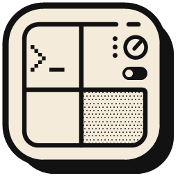

<p align="center"></p>

<h1 align="center">AI DECK</h1>

App de escritorio para Windows que abre una consola real por cada CLI de IA (Claude Code, Antigravity,
DeepSeek via OpenCode, OpenCode y PowerShell) dentro de una sola ventana, con un gestor de ventanas
estilo Windows 11 (ajuste a zonas, mosaico, cascada) y un panel de consumo / cuota de cada agente.

- Cada consola es un PTY real (ConPTY via `node-pty`) con `xterm.js`.
- Al reabrir la app se restauran las consolas y cada CLI retoma su ultima conversacion en la carpeta.
- Deteccion en caliente: un CLI recien instalado aparece sin reiniciar la app.
- Instalacion asistida de los CLI que faltan, siempre mostrando el comando exacto antes de correrlo.
- Espanol / ingles, cinco paletas en modo claro y oscuro.

## Requisitos

- Windows 10/11 x64
- [Node.js](https://nodejs.org) 20 o superior (solo para desarrollar o compilar)
- Los CLI que quieras usar; la app ofrece instalarlos si no los encuentra

## Desarrollo

```powershell
npm install
npm start
```

No hay bundler ni transpilador: se edita y se recarga la ventana con `Ctrl+R`.

## Compilar

```powershell
npm run dist   # instalador + portable en C:\AI-DECK\dist, y copia del instalador en C:\AI-DECK\AI-DECK-Setup.exe
npm run pack   # solo la version desempaquetada, para probar rapido
```

El instalador (`AI-DECK-Setup-<version>.exe`) es la forma recomendada: instala por usuario, sin
permisos de administrador, y arranca en menos de un segundo. El portable descomprime la app en
`%TEMP%` en cada arranque y tarda unos 30 s.

Los builds no estan firmados, asi que SmartScreen avisa la primera vez en otro equipo.

## Seguridad

- Renderer con `contextIsolation`, `sandbox` y sin Node; todo pasa por un preload minimo.
- Content-Security-Policy: solo scripts locales, nada remoto.
- Navegacion, ventanas nuevas, `<webview>` y permisos del navegador bloqueados.
- Cada mensaje IPC se valida contra la pagina propia; las instalaciones exigen confirmacion en un
  dialogo nativo.
- Electron Fuses en el ejecutable: sin `NODE_OPTIONS`, sin `--inspect`, carga solo desde `app.asar`
  con verificacion de integridad.
- La API key de DeepSeek se guarda en el entorno del usuario y nunca pasa por la app ni por su log.

## Datos locales

Configuracion y log en `%USERPROFILE%\.config\ai-hub\` (`config.json`, `ai-hub.log`); la carpeta conserva el nombre
anterior del proyecto para no perder la configuracion existente. Ahi tambien se
pueden sumar agentes propios:

```json
{
  "agents": [{ "id": "mi-cli", "title": "MI CLI", "exe": "mi-cli", "tag": "propio" }]
}
```

## Licencia

[MIT](LICENSE)
